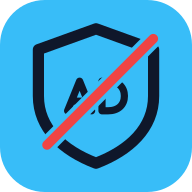

<p align="center">
  
</p>

# AdReaper

> **AdReaper** is an in-app ad remover for Android, built as an LSPosed / Vector (Xposed) module.
> It focuses on the ads that DNS / hosts based blockers cannot touch, with data-driven blocking
> rules and an inspector to track down the ones that still get through.

- [Introduction](#introduction)
- [Highlights](#highlights)
- [Compatibility](#compatibility)
- [Installation](#installation)
- [Blocking rules](#blocking-rules)
- [Inspector mode](#inspector-mode)
- [Developing and Contributing](#developing-and-contributing)
- [Building](#building)
- [Legal and Licensing](#legal-and-licensing)

## Introduction

Network level blockers (DNS, hosts files, VPN based filters) only see traffic. They miss ads that
are served from the same domain as the app's own content, ads that are drawn by an ad SDK inside the
app, and ads protected by certificate pinning. AdReaper works **inside the app process** instead: it
hooks the ad SDKs and the view system, so the ad is never requested or shown, and the empty space it
would have taken is collapsed as well.

How it works:

- **API-based blocking** – intercepts the ad SDK calls (`loadAd`, `show`, `showInterstitial`, ...) of
  50+ ad networks and returns empty results / removes the banner views.
- **Name-based blocking** – watches `ViewGroup.addView()` / `LayoutInflater.inflate()` for known ad
  view classes and collapses them.
- **Activity blocking** – finishes full-screen interstitial / rewarded / app-open ad activities the
  moment they are created.
- **Rule-based blocking** – a JSON rule set (bundled + your own) that can hide views by class or id,
  kill activities and block arbitrary methods, globally or per app.
- **URL filtering** – optional per-app WebView filtering using the bundled host/pattern lists.
- **Per-app control** – Auto / Blacklist / Whitelist modes with per-app toggles and blocking
  statistics.

## Highlights

- **Rule engine** (`blocker/AppRules.java`): block methods, hide views and kill activities from JSON
  without writing or recompiling Java. Rules are loaded from `assets/rules/app_rules.json` and from
  *Settings -> Custom app rules (JSON)*.
- **Modern ad SDK coverage** in the bundled rules: the current entry points of Google Mobile Ads
  (`InterstitialAd.load`, `RewardedAd.load`, `AppOpenAd.load`, ...), AppLovin MAX, Unity LevelPlay /
  IronSource, Liftoff (Vungle) 7+, Meta Audience Network, Chartboost 9+, Smaato, and the full-screen
  activities of the major SDKs.
- **Inspector mode**: finds the ads that are still getting through and prints a ready-to-paste rule
  for them (see [Inspector mode](#inspector-mode)).

> **Note:** the Android package id is a legacy one inherited from the original code base. It is kept
> so existing settings and module scope keep working.

## Compatibility

- **Android 5.0 – 17 (API 21 – 37)**, built against Android 17 (compileSdk 37, targetSdk 36).
- **Framework**: any Xposed-compatible runtime:
  - **LSPosed** (API 93+) – recommended
  - **Vector** (the actively maintained LSPosed successor by JingMatrix, API 93+)
  - Legacy Xposed (API 82+) and EdXposed
- **Root managers**: Magisk, **KernelSU** and **APatch**.

### KernelSU / APatch notes

AdReaper itself needs no special support code to run on KernelSU or APatch – it is a regular LSPosed
module. KernelSU/APatch do not include a Zygisk environment, so install a Zygisk provider first and
then an LSPosed-compatible framework:

1. Install a Zygisk provider module: **ZygiskNext** or **NeoZygisk** (open-source alternative).
2. Install **LSPosed** or **Vector** (the framework runs on top of the Zygisk provider).
3. Install the AdReaper APK and enable it in the framework's manager app, with the
   **"Android" system framework checked in the module scope** (required for the Android 11+
   package-visibility workaround).
4. Reboot and enable AdReaper for the apps you want.

The main screen shows the detected framework (LSPosed / Vector / EdXposed, API version) and root
manager (Magisk / KernelSU / APatch) in the status bar.

## Installation

1. Download the latest APK from the [Releases](https://github.com/kherio/AdReaper/releases) page.
2. Install it as a normal app.
3. Enable the module in your Xposed framework's manager (LSPosed / Vector / Xposed Installer) and
   include the **Android system framework** in the module's scope, then reboot.
4. Open AdReaper and pick a mode:
   - **Auto**: block ads in every app.
   - **Blacklist**: only block in apps you toggle on.
   - **Whitelist**: block everywhere except apps you toggle on.

After enabling an app, force-stop and reopen it so the hooks are applied.

## Blocking rules

Rules are JSON. The same schema is used by the bundled file
([`app/src/main/assets/rules/app_rules.json`](app/src/main/assets/rules/app_rules.json)) and by
*Settings -> Custom app rules (JSON)*. The `"*"` entry applies to every enabled app; a package name
applies to that app only.

```json
{
  "apps": {
    "*": {
      "block_methods": ["com.google.android.gms.ads.appopen.AppOpenAd#load"]
    },
    "com.example.app": {
      "hide_view_ids": ["ad_container", "promo_*"],
      "hide_view_classes": ["com.foo.ads.BannerView"],
      "kill_activities": ["com.foo.ads.FullScreenAdActivity"],
      "block_methods": [
        "com.foo.ads.Interstitial#show",
        { "class": "com.foo.ads.Config", "method": "isAdsEnabled", "result": false }
      ]
    }
  }
}
```

| Key | Meaning |
|---|---|
| `hide_view_classes` | Views whose class name starts with one of these are collapsed. |
| `hide_view_ids` | Views whose id name (`android:id="@+id/ad_container"`) matches. A trailing `*` makes it a prefix. |
| `kill_activities` | Activities whose class name starts with one of these are finished as soon as they are created. |
| `block_methods` | Every overload of the method is skipped. `"Class#method"` is a shorthand for `{ "class": ..., "method": ... }`. |

A blocked method returns a harmless default for its return type: nothing for `void`, `false` / `0`
for primitives, `null` for objects. Use `"result"` to return something else. Classes that do not
exist in the target app are skipped silently, so one global rule can cover many SDKs. Your rules are
merged with the bundled ones. Restart the affected app after changing them.

## Inspector mode

For an ad that is still not blocked:

1. Enable *Settings -> Inspector mode* and make sure AdReaper is enabled for the app.
2. Force-stop the app, open it and wait for the ad to appear (the screen is scanned a few seconds
   after each activity comes to the foreground).
3. Open the module log (LSPosed manager -> Logs -> Modules) and look for lines starting with
   `[AdReaper/Inspector]`. They list the suspicious views (class, id, size) and activities and end
   with a `suggested rule`.
4. Paste that rule in *Settings -> Custom app rules (JSON)*, restart the app and check again.

The inspector only reports; it never blocks anything by itself, and its guesses are heuristics based
on class and id names, so review the suggested rule before using it.

## Developing and Contributing

### Adding support for an ad network or an app

Most cases need **no Java at all**: use the [rule engine](#blocking-rules) and, if the SDK is
generic, add the rule to `assets/rules/app_rules.json`.

Write a Java blocker only when you need logic that rules cannot express:

1.  **Find the ad SDK inside a real app.** Pull the APK (`adb pull` or an APK extractor), open it
    with a decompiler (jadx / APKTool) and look for the SDK's package root. Identify the **banner
    view class** and the **loading/showing methods** (`loadAd`, `showInterstitial`, ...).
2.  **Create a blocker class** in
    `app/src/main/java/**/blocker/adnetwork/`, extending `Blocker`.
3.  **Register it** in the `blockers` array in `Main.java`.
4.  **Build, install, enable, and test** in LSPosed.

#### The `Blocker` contract

```java
public abstract class Blocker {
    abstract public boolean handleLoadPackage(final String packageName, XC_LoadPackage.LoadPackageParam lpparam);
    abstract public String getBanner();
    abstract public String getBannerPrefix();
    public String getName() { return getClass().getSimpleName(); }
}
```

- `handleLoadPackage` – **API-based blocking**. Hook the SDK's ad-loading methods and neuter them.
- `getBanner` / `getBannerPrefix` – **name-based blocking**. Return the banner view class name and
  its package prefix so the `ViewGroup.addView()` / `LayoutInflater.inflate()` hooks can collapse
  the ad's empty space. Return `null`/`null` to skip name-based blocking.

#### The `ApiBlocking` helpers

All helpers return `true` when the target class/method was actually hooked:

| Helper | What it does |
|---|---|
| `removeBanner(pkg, cls, func, lp)` | Hooks a banner method and makes it a no-op so the view collapses |
| `removeBannerWithResult(pkg, cls, func, result, lp)` | Same, but the method returns `result` |
| `blockAdFunction(pkg, cls, func, lp)` | Blocks a method by short-circuiting it |
| `blockAdFunctionExact(pkg, cls, func, param..., lp)` | Blocks only the overload matching the given parameters |
| `blockAdFunctionWithResult(pkg, cls, func, result, lp)` | Blocks and returns `result` instead of executing |
| `blockAdFunctionWithResultExact(pkg, cls, func, params..., result, lp)` | Same, with exact-parameter matching |

`Util.log(pkg, msg)` writes to the Xposed log (enable *Show debug info in Xposed log* in the
settings) – use it to check whether a hook fired.

#### Testing

1. Build and install the debug APK.
2. In LSPosed, enable the module and add the test app to its scope (or use **Auto** mode).
3. Reboot, open the test app, and check the LSPosed log.
4. If the ad is gone **and** the empty space collapses, it works. If only the ad content is gone but
   the space remains, the banner class / id needs to be added (name-based blocking is what removes
   the empty banner space).

## Building

Requirements: JDK 17, Android SDK with platform **android-37** (Android 17).

```bash
./gradlew assembleDebug          # debug APK
./gradlew assembleRelease        # release APK (unsigned, sign with uber-apk-signer)
```

GitHub Actions builds both on every push and pull request, and publishes the APKs as release assets
for tags starting with `v`.

The Xposed API (`de.robv.android.xposed`, API 93) is compiled from the
[XposedBridge](https://github.com/rovo89/XposedBridge) sources and vendored at
`app/libs/api-93.jar` – the `api.lsposed.org` maven is frequently offline, so the jar is checked in
to keep the build hermetic. It is a compile-time stub; the real implementation comes from the
framework at runtime.

## Legal and Licensing

AdReaper is licensed under the [GPL-3.0 license](LICENSE).
